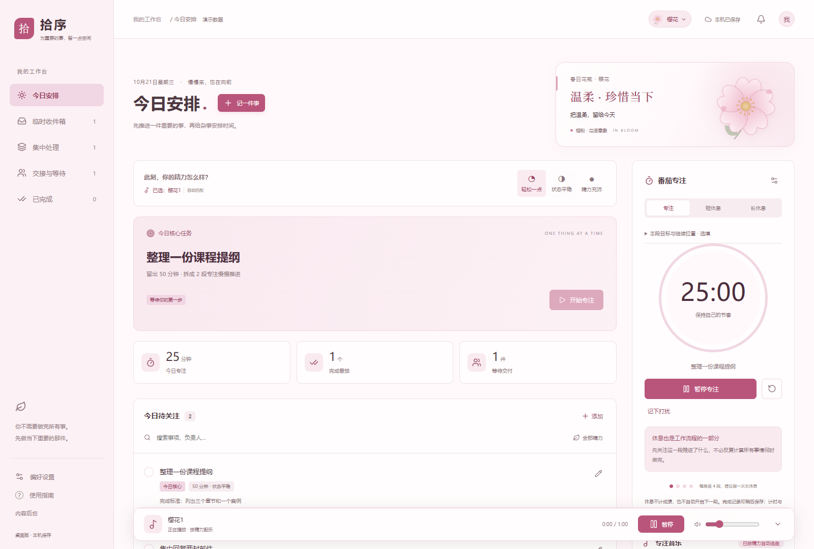
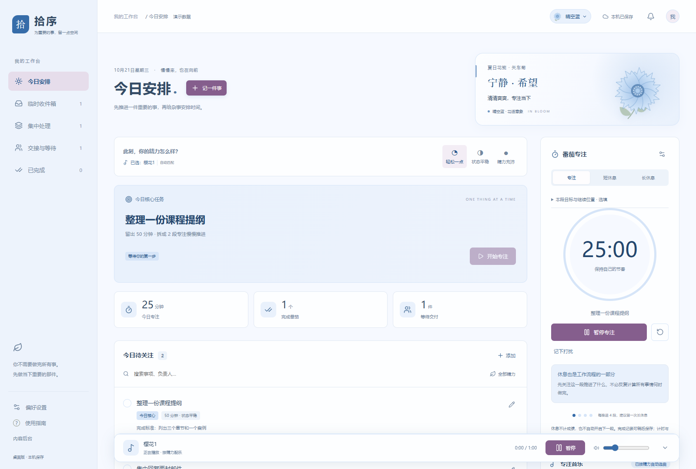
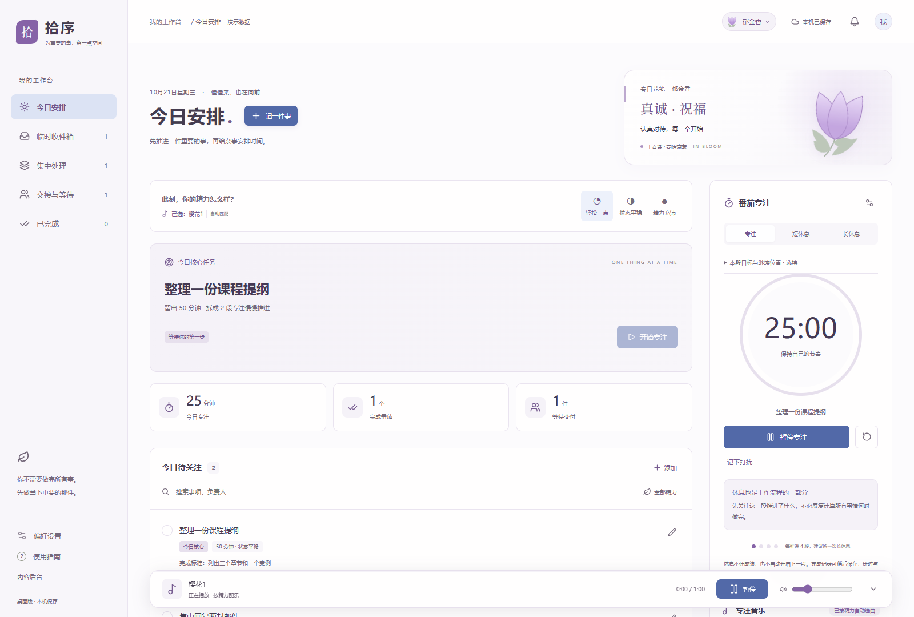
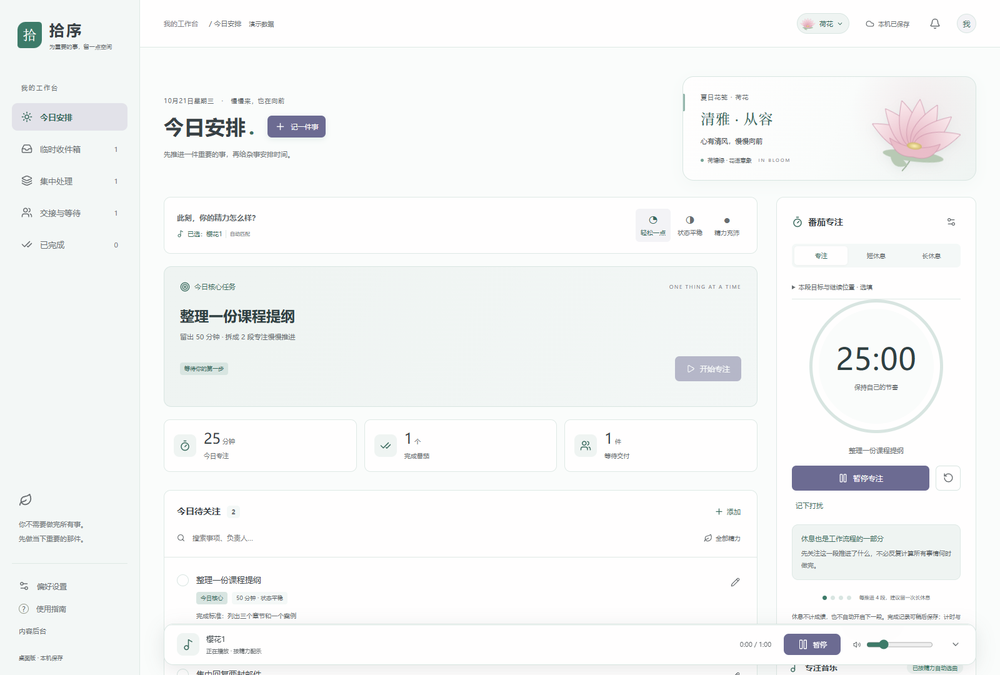
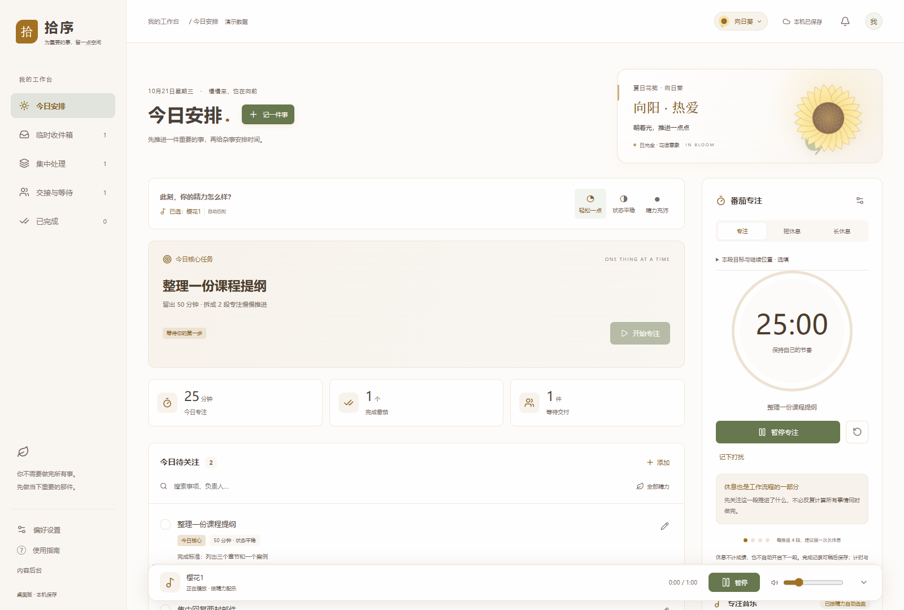
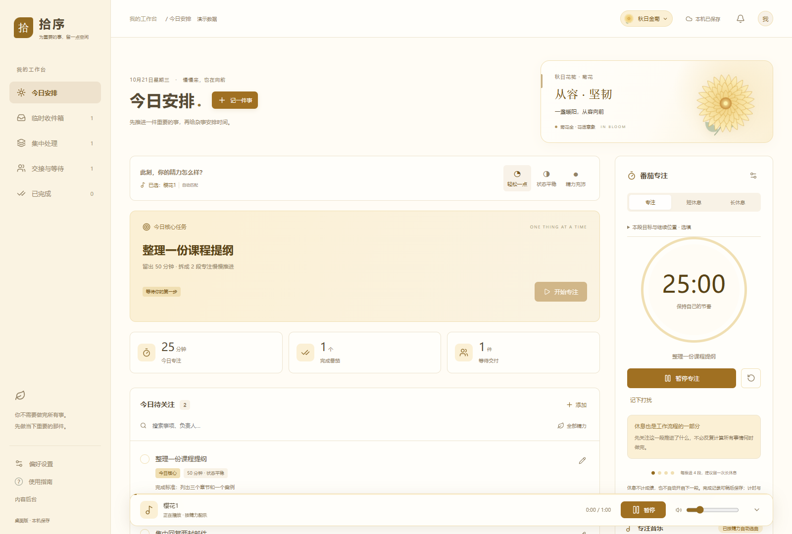
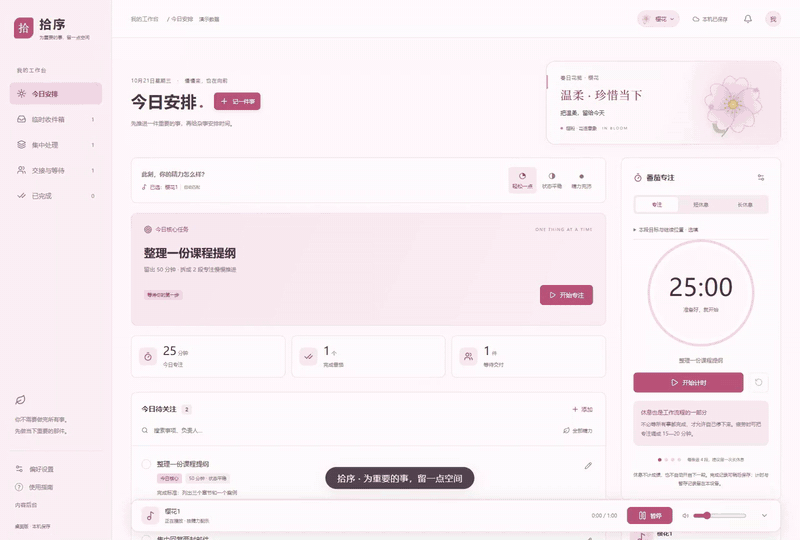

# 拾序 · Shixu

为重要的事，留一点空间。

拾序是一款正在迭代的个人任务与精力管理工具，使用 React、TypeScript、Electron 和 SQLite。当前以 Windows 桌面开发版为主要验证环境，也保留独立网页服务。

## 界面预览

樱花主题：今日任务、番茄专注与底部迷你播放器。



晴空蓝 · 矢车菊：宁静与希望，换一种花语，也换一种心情。



### 更多花色

| 丁香紫 · 郁金香 | 荷塘绿 · 荷花 |
| --- | --- |
|  |  |

| 日光金 · 向日葵 | 菊花金 · 秋日金菊 |
| --- | --- |
|  |  |

## 65 秒操作演示



[下载或观看 65 秒有声视频](docs/media/shixu-demo.mp4)

真实界面操作录屏，使用独立的虚构示例数据。完整视频演示记任务、开始专注、手动选曲、播放与暂停、休息提醒、六种花色及精力自动配乐；背景音乐使用作者明确指定的自创音乐，已混入视频，未单独上传歌曲文件。上面的动图仅用于静音预览。专注到期部分采用加速计时并标注，展示页面内提醒与开始休息，不是 Windows 系统通知弹窗。

## 可以做什么

- 今日核心任务、临时收件箱、集中处理、交接与等待、已完成。
- 番茄专注、短休息、长休息、托盘计时控制和系统提醒。
- 本段目标、进展记录、继续位置和轻量打扰记录。
- 四季花卉主题、花笺寄语及独立内容后台。
- 本机音乐播放、个人文件夹曲库、精力状态配乐和底部迷你播放器。
- 桌面端坚果云 WebDAV 任务同步，支持冲突保留和手动处理。

## 开发运行

需要 Windows、Node.js 24.12 或更新的 24.x 版本和 npm。

```powershell
npm ci
npm run check
npm run test:sync
npm run desktop:dev
```

开发版数据在 Windows 用户目录的 AppData/Roaming/ShixuDevelopment；正式桌面版使用 ShixuDesktop，二者独立。关闭工作台会收进托盘，选择“退出拾序”才完全退出。

源码修改后重新运行开发启动命令会重新构建。Ctrl+R 只重新加载已构建的界面；原生菜单、提醒和后台修改需要完全退出后重开。

## 音乐文件

仓库不包含独立歌曲文件，包括个人曲库和自创歌曲原文件；演示视频按作者授权包含自创背景音乐片段。缺少默认音频时仍可构建，相关曲目无法播放；可以在播放器选择本机音乐文件夹或导入已获授权的音频。

如需使用预设花卉配乐，在 music/ 放入 樱花1.mp3、蓝色矢车菊1.mp3、蓝色矢车菊2.mp3、向日葵1.mp3 后重新构建。原始自创曲目对应 public/audio/original-music.mp3。所有音频均被 Git 排除，上传和商业发行前须另行确认授权。

## 数据与同步

个人任务、SQLite 数据库、备份、账号凭据、浏览器缓存和诊断文件不进入仓库。请通过软件“数据 → 备份数据”生成一致性备份，不要直接复制运行中的 SQLite 主文件。

坚果云同步使用第三方应用密码，请在软件内填写。两台桌面客户端使用相同账号和同步目录；修改后约 30 秒同步，每 10 分钟定时检查，也可立即同步。程序完全退出后不会自动同步。

任务、完成状态、交接信息和已保存的专注记录参与同步；运行中的倒计时、音乐文件、播放状态、音量和花笺寄语暂不参与。

## 独立网页服务

```powershell
npm ci
npm run build
# 复制 .env.example 为 .env，并设置自己的账号及长随机密码
node --env-file=.env server/index.mjs
```

默认端口 3000。桌面自动登录、原生提醒和桌面 WebDAV 连接不能直接等同于网页版能力。公网部署前需自行配置 HTTPS、备份和访问控制。仓库中的 compose.yaml 是早期本机宝塔部署示例，依赖现成的 baota-trial_default 网络，不能视为通用的一键部署方案。

## 当前状态与版本

这是持续迭代中的个人工具。曾发生本机数据库及索引异常，已进行数据恢复和重启检查，完整诱因尚未确定；请保留独立备份，不将其作为关键事务的唯一记录。模拟 WebDAV 检查不等于两台物理电脑的真实同步验收。

版本变化见 [CHANGELOG.md](CHANGELOG.md)。本仓库只管理代码；GitHub 不能替代个人任务的同步或备份。

## 使用与权利

© 2026 车牮。当前未授予开源许可证，保留所有权利。上传 GitHub 私有仓库不代表开放商用、转载或再分发授权。第三方组件遵循各自许可证，音乐权利独立。
